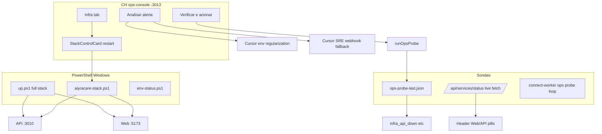

# Auditoria — monitoramento e resiliência infra (13/10/2026)

Relato do Rafael (notebook, Ambiente 1): web + API caíram; reinício pela aba **Infra** do CH (`:3013`); web voltou e API continuou down; alerta `infra_api_down` persistiu; **Verificar e acionar** / **Analisar → Disparar agente** para validar a cadeia.

Este documento cruza o relato com o código em `origin/main` e com o PR de melhorias `cursor/infra-health-resilience-improvements-4c51` (merge **#169**).

---

## Linha do tempo (cenários)

| # | O que Rafael viu | Mecanismo no repo | Interpretação |
|---|------------------|-------------------|---------------|
| 1 | Web + API down | Sondas: `GET /api/services/status` (header CH) + artefato `ops-probe-last.json` (alertas) | Ambos podem marcar down; CH continua no ar (ops-console não é reiniciado pelo stack control). |
| 2 | Restart na Infra | `POST /api/stack/restart` → `scripts/aiyracare-stack.ps1 -Action restart` | **Não** é `scripts/up.ps1`. Só mata/reinicia processos nas portas API + Web. |
| 3 | Web OK, API down | `Wait-ForStack` (antes 25s, agora 45s padrão) + Vite sobe mais rápido que API `tsx watch` | Padrão esperado em cold start lento ou crash da API (PG, migração, env). UI web pode carregar shell mesmo sem API. |
| 4 | Alerta infra persistiu | `evaluateOpsAlerts` lê probe do artefato; até rodar probe de novo, alerta pode refletir estado **anterior** | Real se API ainda down; **falso prolongado** se API já subiu mas probe não rerodou. |
| 5 | Disparar agente | Manual: `POST /api/ops-alerts/infra_api_down/analyze` → webhook Cursor. Auto: `checkAndDispatch` se critical infra + `humanRequired` | Com `CURSOR_INFRA_ENV_REGULARIZATION_*`: agente **regularização ambiente** (remediação limitada). Senão: Suporte SRE Tier 0 (só rascunho). |

---

## Mapa: quem faz o quê

| Entrada | Escopo | Espera health API | Ops-console / notifier |
|---------|--------|-------------------|-------------------------|
| `up.ps1` | API → CH → notifier → web | 12s (legado) → **45s** (`AIYRA_API_HEALTH_WAIT_SEC`) | Sobe tudo |
| `aiyracare-stack.ps1` restart | API + web only | **45s** (`AIYRA_STACK_HEALTH_WAIT_SEC`) | Não mexe |
| `npm run env:status` | Só HTTP GET em 3010/3020/5173/5174/3013/3023 | Timeout 4s por URL | Informativo |

---

## Fontes de health (real vs artefato)

| Fonte | Onde | Live? | Usado para |
|-------|------|-------|------------|
| `fetchServicesStatus` | `packages/ops-console/src/services-status.ts` | Sim (12s timeout) | Pílulas Web/API no header CH |
| `runOpsProbe` | `ops-probe.service.ts` | Sim quando executado | Grava `scripts/output/ops-probe-last.json` |
| `readOpsProbeArtifact` | `ops-metrics.service.ts` | Não | Alertas na UI, runtime degradado |
| `ops:smoke` | scripts | Configurável `OPS_SMOKE_*` | Gates CI / promoção |
| Failure Probes (produto) | web/RN SDK | Eventos `client_errors` | INC técnicos — **não** é a mesma sonda que `infra_api_down` |

**Alerta real:** probe live falha (`!probe.api.ok`) — API não responde OK em `API_PUBLIC_URL/health` ou Postgres da pool do console falha.

**Alerta / UI defasados:** API já healthy mas artefato antigo; auto-refresh 60s do CH recarrega métricas **sem** rerodar probe até **Verificar e acionar**, worker, ou (após #169) fim de restart/start do stack.

**Falso positivo operacional (não bug de sonda):** `up.ps1` imprimia `FAIL` com API ainda subindo (&lt;12s tsx cold start). Notebook agente interpretava como stack quebrado; API podia ficar healthy segundos depois.

---

## Runtime degradado (migration 052)

Quando `isOpsProbeDegraded(probe)` após um ciclo de probe, `buildRuntimeStateFromOps` ativa `degradedRead` com `reason: 'infra_probe'` (TTL em `DEGRADED_READ_TTL_MS`). Isso é **contingência de leitura D-1** no app, não substitui subir a API.

Persistência: `runtime_degraded_state` (PG). Independente de `OPS_PLANNED_MAINTENANCE` (suprime dispatch/ stack em modo read-only).

---

## Agente a partir do alerta infra

| Gatilho | Código | Agente |
|---------|--------|--------|
| **Verificar e acionar** | `POST /api/alerts/check` → `runProbeCycle` + `checkAndDispatch` + `maybeAutoInvestigate` | Auto só `category=infra`, `severity=critical`, `humanRequired` (ex.: `infra_api_down`) |
| **Analisar → Disparar agente** | `requestAnalysis` manual, sem cooldown | Webhook por alerta (ver abaixo) |
| Pré-requisitos | `CURSOR_INFRA_ENV_REGULARIZATION_*` **ou** `CURSOR_SRE_SUPPORT_*` | Sem webhook → `investigator_unavailable` na UI |

| `infra_api_down` + env | Webhook | Comportamento |
|------------------------|---------|---------------|
| `CURSOR_INFRA_ENV_REGULARIZATION_*` configurado | Lane regularização | Playbook `infra-env-regularization`, `machineHint`, remediação 1× — ver [`docs/ops/INFRA_ENV_REGULARIZATION_AGENT.md`](ops/INFRA_ENV_REGULARIZATION_AGENT.md) |
| Fallback | `CURSOR_SRE_SUPPORT_*` | Tier 0 SRE — `ops-alert-tier0`, só markdown |

**Lacunas (pré-#169 / agente)**

1. Restart do stack não rerodava probe → **corrigido em #169**.
2. Investigador SRE não executa restart → **agente regularização** (P1).
3. CH header (live) vs tabela de alertas (artefato) podem divergir na mesma tela.
4. `env:status` não coordena com CH nem dispara probe.

---

## CH #168 (relevância limitada)

[PR #168](https://github.com/RafaDru/aiyra-care/pull/168) trata **bridge `client_error` → Triador Dev** e relaxa `GET /api/incident-dispatch/health` quando SRE falta. É paralelo ao fluxo **`infra_api_down`**. **Não** corrige restart nem probe infra.

---

## Causas prováveis do 13/10 (hipóteses ordenadas)

1. **API lenta ou falha real** após restart (PG parado, `api.log` com exceção, porta ocupada por processo zumbi).
2. **Janela de espera curta** (25s stack / 12s `up.ps1`) com web já UP — sensação «metade recuperou» (**mitigado em #169**).
3. **Probe stale** — header verde/amarelo live vs alerta crítico até **Verificar e acionar** (**mitigado parcialmente em #169** pós-restart).
4. **Falso FAIL no console** ao rodar `up.ps1` em paralelo ao CH — ruído para operador/agente notebook (**mitigado em #169**).

---

## Recomendações

### P0 (entregue — #169)

| Item | Ação |
|------|------|
| Alinhar espera API | `up.ps1`: 45s + `AIYRA_API_HEALTH_WAIT_SEC`; mensagem aponta `api.log` |
| Alinhar stack restart | `aiyracare-stack.ps1`: `Wait-ForStack` 45s + `AIYRA_STACK_HEALTH_WAIT_SEC` |
| Probe pós-restart | `ops-console` server: `runProbeCycle` + `runtimeService.applyFromOps` após start/restart |
| UI pós-restart | `StackControlCard`: poll `stackStatus` ~44s + aviso se parcial |
| Runbook | Diferença **Restart CH** vs **`up.ps1`** em `docs/ops/RUNBOOK_ALERTS.md` |

### P1

- **Agente regularização ambiente** — webhook `CURSOR_INFRA_ENV_REGULARIZATION_*`, payload `alert_kind` + `machineHint`, playbook remediação limitada: [`docs/ops/INFRA_ENV_REGULARIZATION_AGENT.md`](ops/INFRA_ENV_REGULARIZATION_AGENT.md).
- Após restart bem-sucedido, botão opcional «Atualizar sondas» (probe sem dispatch webhook) para evitar acionar SRE só para limpar alerta.
- Unificar métricas: `getMetrics` rodar probe se artefato &gt; N min ou `checkedAt` &lt; stack `checkedAt`.
- Documentar no CH: web «no ar» ≠ API healthy (login/sync falham).

### P2

- Ordem de restart: API healthy antes de web (ou banner «API iniciando» no Vite proxy).
- Métricas de cold-start p95 em `product_events` para calibrar waits.
- Auto-restart API **uma vez** se probe falha pós-restart (policy — decidir com Rafael).

---

## PR de código

| PR | Branch | Escopo |
|----|--------|--------|
| **#169** (merged) | `cursor/infra-health-resilience-improvements-4c51` | Waits 45s, probe pós-restart, UI stack |
| **draft** | `cursor/infra-env-regularization-agent` | Agente regularização + dispatch payload |

---

## Referências repo

- `packages/ops-console/src/stack-control.ts`, `scripts/aiyracare-stack.ps1`, `scripts/up.ps1`
- `packages/api/src/domain/ops/ops-alerts.ts`, `ops-probe.service.ts`, `runtime-degraded.service.ts`
- `docs/ops/RUNBOOK_ALERTS.md`, `docs/OPS_FALLBACKS_AND_ALERTS.md`, `docs/ops/INFRA_ENV_REGULARIZATION_AGENT.md`
