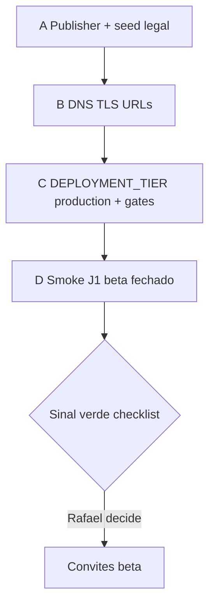

# Wave go-live beta — sequência agentica (prep)

> **Última atualização:** 2026-10-29  
> **Escopo:** preparação documentada + secrets fora do git — **sem deploy produção** nesta wave.  
> **Checklist mestre:** [`docs/product/MVP_GO_LIVE_CHECKLIST.md`](../product/MVP_GO_LIVE_CHECKLIST.md)

Ordem recomendada antes de abrir **beta fechado** (famílias convidadas) no domínio público. Cada passo indica **agente** (Cloud Agent / notebook / CI) vs **Rafael** (decisão ou dado que não entra no repositório).

---

## Pré-requisitos eng já mergeados (wave MVP)

| PR | Entrega | Checklist |
|----|---------|-----------|
| [#176](https://github.com/RafaDru/aiyra-care/pull/176) | Landing `/home`, footer institucional, links legais, SEO base | Pilar 1 |
| [#177](https://github.com/RafaDru/aiyra-care/pull/177) | Anel A: convênio/SUS e pagamento fora do 1º onboarding | Pilar 2 |
| [#178](https://github.com/RafaDru/aiyra-care/pull/178) | `DEPLOYMENT_TIER=production` + gate scrape privado | Pilar 3.6 |

---

## (A) Publisher legal + seed de documentos

**Objetivo:** `GET /compliance/contact` e páginas `/termos`, `/privacidade`, `/cookies` servindo markdown versionado de `docs/legal/`.

| # | Ação | Quem | Evidência |
|---|------|------|-----------|
| A.1 | Migration `031` aplicada no host alvo (preview/beta PG) | Agente | `migrate:all` / `preview:post-deploy` verde |
| A.2 | Seed: `node packages/api/scripts/seed-legal-documents.mjs` | Agente | `GET /compliance/documents` lista kinds `is_current` |
| A.3 | Configurar **publisher API** (secrets — **não** commitar CNPJ real) | Agente configura keys; **Rafael** fornece razão social/CNPJ quando PJ regularizada | Ver tabela abaixo + [`.env.example`](../../.env.example) |
| A.4 | Opcional build web: `VITE_LEGAL_*`, `VITE_PUBLIC_SITE_URL` no deploy da imagem web | Agente | Footer `/home` e `PageMeta` com canonical correto |
| A.5 | Revisão jurídica dos textos em `docs/legal/` | **Rafael** + advogado | [`HUMAN_REVIEW_QUEUE.md`](../HUMAN_REVIEW_QUEUE.md) |

### Variáveis — grupo «compliance publisher»

Nomes usados em runbooks (`COMPLIANCE_PUBLISHER_*`) mapeiam para as chaves **reais** no runtime da API:

| Runbook / doc | Variável API | Web (build Vite) |
|---------------|--------------|------------------|
| `COMPLIANCE_PUBLISHER_ENTITY_NAME` | `LEGAL_ENTITY_NAME` | `VITE_LEGAL_ENTITY_NAME` (fallback) |
| `COMPLIANCE_PUBLISHER_CNPJ` | `LEGAL_CNPJ` (14 dígitos) | `VITE_LEGAL_CNPJ` (fallback) |
| `COMPLIANCE_PUBLISHER_PRIVACY_EMAIL` | `LEGAL_PRIVACY_EMAIL` | — |
| `COMPLIANCE_PUBLISHER_SUPPORT_EMAIL` | `LEGAL_SUPPORT_EMAIL` | — |
| `COMPLIANCE_PUBLISHER_ADDRESS` | `LEGAL_ENTITY_ADDRESS` | — |

Canon técnico: [`LEGAL_COMPLIANCE.md`](../LEGAL_COMPLIANCE.md) · seed §5.

**Agente:** aplicar valores em GitHub Environment / GCP Secret Manager / `.env` local ignorado.  
**Rafael:** CNPJ e razão social definitivos; e-mails `privacidade@` / suporte operacionais.

---

## (B) Domínios `aiyra-care.com.br` / `aiyracare.com.br`

**Objetivo:** TLS válido, URLs públicas consistentes (web, API, OAuth).

| # | Ação | Quem | Notas |
|---|------|------|-------|
| B.1 | Decisão canonical (www vs apex, qual domínio primário) | **Rafael** | Decisão 2026-10-26 em [`HISTORICO.md`](../HISTORICO.md) |
| B.2 | Registro DNS + registros A/AAAA ou CNAME → Cloud Run / CDN | **Rafael** (registrar) + agente (valores no runbook) | Checklist pilar 4.1–4.2 |
| B.3 | Certificado TLS (managed Cloud Run / LB) | Agente (IaC/deploy) | Smoke HTTPS |
| B.4 | `API_PUBLIC_URL=https://api.<domínio>` no secret do host API | Agente | OAuth calendar, callbacks internos |
| B.5 | Build web: `VITE_PUBLIC_SITE_URL=https://www.<domínio>` | Agente | Canonical/OG em [`PageMeta`](../../packages/web/src/components/seo/PageMeta.tsx) |
| B.6 | Supabase Auth: Site URL + redirect URLs para o domínio beta | Agente (doc + console) | [`SUPABASE.md`](../SUPABASE.md) |
| B.7 | E-mail transacional no domínio ou SPF/DKIM documentado | **Rafael** (policy) + agente (`TRANSACTIONAL_EMAIL_*`) | Pilar 4.4 |

**Agente:** atualizar secrets, rebuild imagem web, validar redirects.  
**Rafael:** compra/renew DNS, SPF/DKIM com provedor de e-mail.

Runbooks deploy: [`DEPLOY_BETA_RUNBOOK.md`](./DEPLOY_BETA_RUNBOOK.md) · GCP preview → beta: [`GCP_PREVIEW_RUNBOOK.md`](./GCP_PREVIEW_RUNBOOK.md).

---

## (C) `DEPLOYMENT_TIER=production` + gate scrape

**Objetivo:** ambiente beta trata-se como produção para Connect (sem showcase público de credenciais).

| # | Ação | Quem | Evidência |
|---|------|------|-----------|
| C.1 | `DEPLOYMENT_TIER=production` no host beta (não confundir com «prod final» — tier de comportamento) | Agente | [`connect-showcase-not-production`](../principles/connect-showcase-not-production.md) |
| C.2 | Gate scrape eng [#178](https://github.com/RafaDru/aiyra-care/pull/178) — rotas sensíveis bloqueadas fora de integração | Agente (já em `main`) | Testes ops / princípio acima |
| C.3 | `COMPLIANCE_GATE_ENABLED=1` quando jurídico OK | Agente + **Rafael** (go jurídico) | Pilar 3.3 |
| C.4 | `npm run promotion:gates` verde no Ambiente 1 | Agente | Pilar 5.1 |

**Rafael:** liberar `COMPLIANCE_GATE_ENABLED=1` após revisão jurídica (não bloquear beta fechado interno se gate ainda `0` — registrar exceção datada no [`HISTORICO.md`](../HISTORICO.md)).

---

## (D) Beta fechado — smoke J1

**Objetivo:** jornada **J1** (pai/mãe) documentada e suites verdes antes de convites externos.

| # | Ação | Quem | Referência |
|---|------|------|------------|
| D.1 | Smoke J1 no notebook (My Machines): `auth-entry-flow`, `onboarding-flow`, `core-patient-crud`, `dashboard-people-grouping` | Agente (`aiyracare-qa-notebook`) | [`USABILITY_JOURNEYS.md`](../product/USABILITY_JOURNEYS.md) · [`ONBOARDING_MVP_GATE.md`](../product/ONBOARDING_MVP_GATE.md) |
| D.2 | Regressão lane `regression` ou `business-full` | Agente | [`QA_PROCESS.md`](../testing/QA_PROCESS.md) |
| D.3 | Preview validado local ou GCP | Agente | [`PREVIEW_LOCAL_TEST_GUIDE.md`](./PREVIEW_LOCAL_TEST_GUIDE.md) |
| D.4 | Lista fechada de beta testers / feature flag | **Rafael** (quem convida) + agente (doc env) | Pilar 5.7 |
| D.5 | Decisão estratégica «abrir beta» | **Rafael** | [`OPS_SOLO_OPERATOR_CHARTER.md`](../OPS_SOLO_OPERATOR_CHARTER.md) |

Pós-deploy obrigatório quando houver host: `npm run preview:post-deploy` — [`DEPLOY_BETA_RUNBOOK.md`](./DEPLOY_BETA_RUNBOOK.md).

---

## Fluxo resumido

---

## O que **não** fazer nesta wave doc-only

- Promover deploy produção final ou Stripe live sem checklist pilar 3 completo.
- Commitar CNPJ, chaves API ou `.env` com secrets reais.
- Marcar go-live público com itens `[ ]` críticos em CNPJ, jurídico ou DNS.

---

## Ver também

| Tema | Documento |
|------|-----------|
| Checklist pilares 1–5 | [`MVP_GO_LIVE_CHECKLIST.md`](../product/MVP_GO_LIVE_CHECKLIST.md) |
| Skill agente go-live | [`.cursor/skills/aiyracare-mvp-go-live/SKILL.md`](../../.cursor/skills/aiyracare-mvp-go-live/SKILL.md) |
| Readiness técnico | [`GO_LIVE_TECHNICAL_READINESS.md`](../GO_LIVE_TECHNICAL_READINESS.md) |
| Pipeline entrega | [`DELIVERY_PIPELINE.md`](../DELIVERY_PIPELINE.md) |
