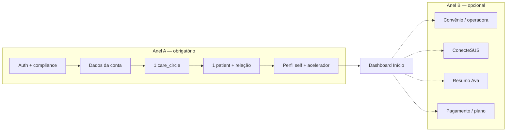

# Gate de onboarding — MVP B2C família (Anel A / Anel B)

> **Última atualização:** 2026-10-27  
> **Persona alvo:** [`persona-parent-guardian`](./PERSONAS.md)  
> **Jornada:** [J1 — «Primeira noite no app»](./USABILITY_JOURNEYS.md#j1--primeira-noite-no-app-conta--filho-no-início)  
> **Implementação atual:** [`auth-entry-onboarding`](../features/auth-entry-onboarding.md) (conectores no wizard ainda existem — ver [gap](#gap-implementação-vs-gate))

Este documento fixa **o que é obrigatório antes do primeiro uso útil** do app (Anel A) versus o que pode ser coletado depois (Anel B — *progressive profiling*). Pagamento, convênio e SUS **não** bloqueiam o go-live do onboarding.

---

## Visão em dois anéis

| Anel | Nome | Quando | Objetivo |
|------|------|--------|----------|
| **A** | Gate MVP | Primeira sessão (até liberar **Início** `/`) | Conta válida + 1 família + ≥1 pessoa de saúde com relação de cuidado clara |
| **B** | Perfil progressivo | Dias/semanas seguintes; banners, Ava, Configurações | Convênio, SUS, labs, segundo guardião, export, aceleradores adicionais |



---

## Anel A — obrigatório (critérios de negócio)

O usuário **não** acessa o dashboard principal de forma estável até concluir todos os itens abaixo (exceto resumo Ava, marcado opcional).

### 1. Conta (titular)

| Campo | Obrigatório no MVP | Notas |
|-------|-------------------|--------|
| CPF | Sim | Validação e unicidade (`POST /auth/complete-profile`) |
| Nome civil | Sim | |
| E-mail | Sim | Confirmação Supabase informativa — não bloqueia gate se projeto desabilitar confirmação |
| Telefone (celular) | Sim | Contato e recuperação |
| Endereço | Sim | CEP + logradouro (ViaCEP); número/complemento conforme UI |
| Senha | Sim **se** cadastro e-mail/senha | |
| Senha após login social | **P1** | OAuth (Google etc.): definir senha local ou recovery **fora** do Anel A inicial |
| Pagamento / assinatura | **Fora do Anel A** | Billing em Anel B ou fluxo comercial separado |

**API de referência:** `POST /auth/complete-profile` · flag `needsProfile: false` só após perfil titular válido.

### 2. Uma família (`care_circle`)

- Exatamente **≥1** círculo nomeado na primeira passagem (spec [`ONBOARDING_FAMILY_NAME_STEP`](../features/ONBOARDING_FAMILY_NAME_STEP.md)).
- O **1º** círculo vincula o titular (`self`) quando aplicável.
- Multi-família no mesmo wizard: **P1**; MVP exige **1 família + 1 pessoa** (não zero círculos).

### 3. Uma pessoa de saúde

- **≥1** `patient` no 1º círculo (menor ou adulto sob cuidado).
- Campos mínimos: identificação + data de nascimento; **consentimento de menor** quando aplicável (guardião).
- Atalho «pular membros» **não** pode deixar o gate sem nenhum paciente além de `self` — ver critérios [done](#critérios-done-anel-a).

### 4. Perfil `self` e acelerador

- Titular com membership `self` no 1º círculo.
- **Acelerador G1** disponível no contexto do titular (dock Ava + pin `self` / «histórico de saúde») — leitura; sem obrigar conversa.

### 5. Relação de cuidado

- Para cada pessoa adicionada no gate: papel explícito (ex.: guardião ↔ dependente) alinhado a [`FAMILY_ACCESS_MODEL.md`](../FAMILY_ACCESS_MODEL.md) (`patient_memberships`, vínculo ao círculo).
- Copy deve deixar claro **quem** cuida de **quem** (evita perfil órfão no Início).

### 6. Resumo Ava (opcional no Anel A)

- Oferta de resumo inicial («o que posso fazer por você») **pode** aparecer após o gate; **não** bloqueia `Ir para o início`.
- Qualidade de LLM: fora de escopo de regressão ([`AVA_QA_SCOPE.md`](../testing/AVA_QA_SCOPE.md)).

### 7. Convênio e SUS — **100% opcionais no 1º onboarding**

| Regra MVP | Detalhe |
|-----------|---------|
| Sem passo dedicado | Nenhuma tela obrigatória «Vincule seu convênio» ou «Conecte o SUS» no fluxo Anel A |
| Sem ramo «não tenho» | Não forçar declaração negativa; usuário segue para o Início e descobre integrações depois (Anel B) |
| Onde vive depois | Aba **Integrações**, hints na **Carteira**, jornada [J2](./USABILITY_JOURNEYS.md#j2--carteirinha-e-plano-integração--carteira) |

Labs, hospitais e demais conectores seguem a mesma regra: **Anel B** apenas.

---

## Anel B — progressive profiling (não bloqueia Início)

Coleta e incentivo **após** o gate, via empty states, banner pós-onboarding, Configurações e Ava.

| Tema | Exemplos | Prioridade MVP |
|------|----------|----------------|
| Convênio / operadora | Link + primeira sync | P0 fluidez na jornada J2, mas **não** no wizard inicial |
| SUS (ConecteSUS) | Import guiado gov.br | Opcional |
| Segundo guardião | Convite co-responsável | P0 produto ([`persona-co-parent-invited`](./PERSONAS.md)), Anel B |
| Pagamento | Stripe / plano | Comercial |
| Senha pós-OAuth | Definir senha na conta | P1 |
| Tour / primeiros passos | `first-visit-guided-ux` | Planejado |
| Dados clínicos manuais | Exames, meds, vacinas | Suites ainda parciais na matriz |

Telemetria sugerida: eventos `progressive_profile_*` (futuro) distinguindo Anel B de `onboarding_step` do Anel A.

---

## Critérios done (Anel A)

Considerar o **gate MVP atendido** quando **todos** os itens abaixo são verdadeiros em Ambiente 1 (`:3010` + `:5173`) ou preview equivalente:

1. **Conta:** `POST /auth/complete-profile` retorna sucesso com CPF, nome, e-mail, celular e endereço válidos.
2. **Compliance:** aceites legais pendentes resolvidos antes ou durante o wizard ([`LEGAL_COMPLIANCE.md`](../LEGAL_COMPLIANCE.md)).
3. **Família:** `GET /care-circles` lista **≥1** círculo criado no onboarding (não só backfill tardio).
4. **Pessoa:** **≥1** paciente dependente (ou perfil cuidado explícito) vinculado ao círculo; titular `self` presente.
5. **Relação:** memberships coerentes (guardião no menor); Início mostra a pessoa em «Quem você cuida».
6. **Sem convênio/SUS no gate:** fluxo Anel A **não** exige passo de conector nem CTA «não tenho convênio/SUS».
7. **Destino:** usuário chega a `/` com agrupamento por círculo; sem loop infinito no wizard.
8. **Opcional:** resumo Ava dispensável sem impedir (6).

### Gap implementação vs gate

| Hoje (out/2026) | Gate MVP (este doc) |
|-----------------|---------------------|
| Wizard pode exibir conectores SUS/convênio com **Pular** | Conectores **ausentes** do Anel A |
| `complete-profile` pode liberar dashboard antes do loop família | Gate exige **1 família + 1 pessoa** antes do Início estável |
| Documentado em [`auth-entry-onboarding`](../features/auth-entry-onboarding.md) | PRs de produto devem alinhar UI/rotas a este gate |

Rastrear alinhamento no épico `institutional-landing` e feature `auth-entry-onboarding`.

---

## QA — jornada J1

Executar antes de declarar onboarding «MVP gate OK» em preview ou domínio público:

```bash
npm run qa:reset-onboarding-user   # quando usar fixture qa-onboarding
npm run qa:run -- --suite auth-entry-flow
npm run qa:run -- --suite onboarding-flow
npm run qa:run -- --suite core-patient-crud
npm run qa:run -- --suite dashboard-people-grouping
```

| Suite | O que valida no J1 |
|-------|-------------------|
| [`auth-entry-flow`](../testing/suites/auth-entry-flow.md) | Landing, login/signup, perfil titular, wizard família |
| [`onboarding-flow`](../testing/suites/onboarding-flow.md) | Gate regressão conta dedicada |
| [`core-patient-crud`](../testing/suites/core-patient-crud.md) | Criança no Início pós-gate |
| [`dashboard-people-grouping`](../testing/suites/dashboard-people-grouping.md) | Agrupamento por círculo |

**Relatório:** `Jornada J1 — PASS/FAIL` + suites acima ([ritual em USABILITY_JOURNEYS](./USABILITY_JOURNEYS.md#relatório-no-chat-definition-of-done)).

**Nota:** até a UI remover conectores do Anel A, cenários E2E que **pulam** conectores continuam válidos como regressão; o critério 6 do done é verificado manualmente ou por suite futura `onboarding-mvp-gate`.

---

## Referências

- [`PERSONAS.md`](./PERSONAS.md) · [`USABILITY_JOURNEYS.md`](./USABILITY_JOURNEYS.md) · [`MVP_GO_LIVE_CHECKLIST.md`](./MVP_GO_LIVE_CHECKLIST.md)
- [`../FAMILY_ACCESS_MODEL.md`](../FAMILY_ACCESS_MODEL.md) · [`../features/ONBOARDING_FAMILY_NAME_STEP.md`](../features/ONBOARDING_FAMILY_NAME_STEP.md)
- [`../testing/BUSINESS_ACTION_MATRIX.md`](../testing/BUSINESS_ACTION_MATRIX.md)
