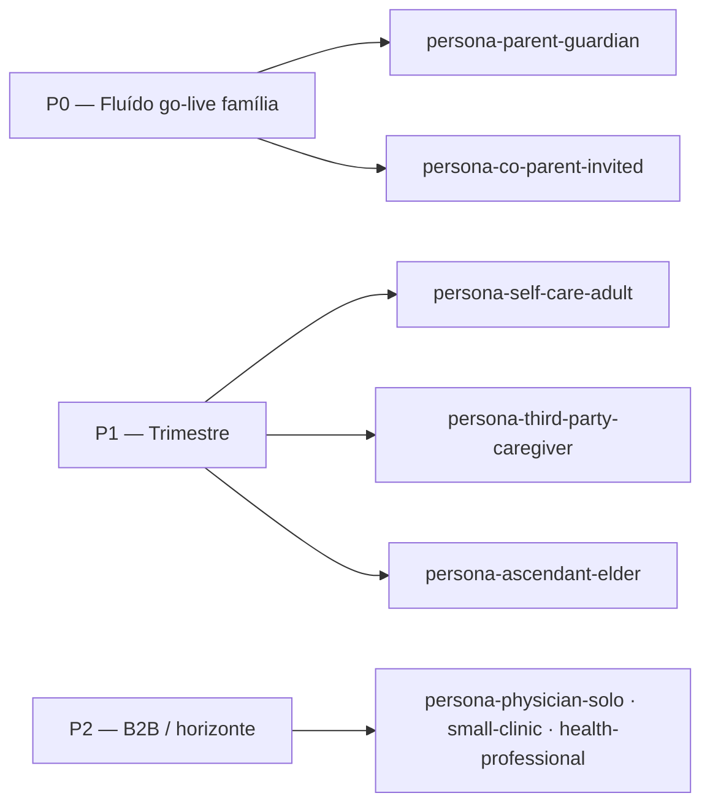

# Personas oficiais — AiyraCare

> **Última atualização:** 2026-10-26  
> **Status:** canon do repositório para produto, QA e roadmap.  
> **Relacionado:** [`USABILITY_JOURNEYS.md`](./USABILITY_JOURNEYS.md), [`../ECOSYSTEM.md`](../ECOSYSTEM.md), [`../FAMILY_ACCESS_MODEL.md`](../FAMILY_ACCESS_MODEL.md), [`../product-terminology.md`](../product-terminology.md).

## Como usar este documento

| Campo | Significado |
|-------|-------------|
| **ID** | Identificador estável — usar em fixtures QA, telemetria e épicos (`persona:<id>`). |
| **MVP** | **P0** = fluidez obrigatória para go-live B2C família; **P1** = importante no trimestre; **P2** = horizonte / B2B / nicho. |
| **Conta × família** | Ver três camadas em [`FAMILY_ACCESS_MODEL.md`](../FAMILY_ACCESS_MODEL.md): **conta** (login/pagamento), **família/círculo** (`care_circle`), **perfil de saúde** (`patient`). |

**Primeira persona operacional (decisão 2026-10-26):** `persona-parent-guardian` — pai/mãe ou ascendente que cuida de **crianças** no dia a dia.

---

## Núcleo B2C — usuários de entrada

### `persona-parent-guardian` — Responsável por crianças (P0)

| | |
|--|--|
| **Quem é** | Pai, mãe ou ascendente (avó/avô) que centraliza saúde de um ou mais **menores** (e eventualmente o próprio perfil `self`). |
| **Goals** | Cadastrar filhos rápido; ver carteirinha e autorizações; registrar vacina/febre/consulta; convidar o outro responsável; levar contexto na pediatra. |
| **Dores** | Dados espalhados (convênio, lab, WhatsApp do pediatra); login em vários portais; esquecer o que foi feito “hoje”; medo de errar consentimento de menor. |
| **Conta × família** | Titular ou co-admin do **círculo**; `patient_memberships.role = guardian` nos filhos; perfil `self` opcional no mesmo login. |
| **Superfície MVP** | Web completa; mobile leitura + registro rápido + Ava (paridade 80/20 — ver [`MOBILE_WEB_DUAL_DELIVERY.md`](../MOBILE_WEB_DUAL_DELIVERY.md)). |
| **Honestidade (out/2026)** | Onboarding e Início «Quem você cuida» **operacionais**; abas clínicas manuais (exames, meds, vacinas) com suites QA ainda **⬜** na matriz; sync real de portal depende de sessão/WAF (lane separada). |

### `persona-co-parent-invited` — Cônjuge ou co-responsável convidado (P0)

| | |
|--|--|
| **Quem é** | Segundo guardião (ex.: mãe/pai na custódia compartilhada) que **aceita convite** e precisa ver só os filhos certos. |
| **Goals** | Entrar sem refazer cadastro dos filhos; atualizar agenda e registros; respeitar visibilidade (não ver filho do outro núcleo). |
| **Dores** | Medo de “ver tudo” da família do ex; convite confuso; duplicar paciente. |
| **Conta × família** | Conta **própria**; acesso via `patient_access_grants` + convite; pode pertencer a outro `care_circle`. |
| **MVP** | P0 junto com guardião — sem isso a persona P0 falha na vida real. |
| **Honestidade** | UI `/settings/family` e grants **operacionais**; matriz 5 logins (`family-matrix`) **parcial** em E2E (smoke UI; cenário Mariana multi-círculo = fase 3). |

### `persona-third-party-caregiver` — Cuidador terceiro (P1)

| | |
|--|--|
| **Quem é** | Babá, enfermeiro, cuidador de idosos/crianças **sem** ser titular da assinatura. |
| **Goals** | Registrar sintoma/medida no dia; ver alergias e meds; **não** administrar billing nem convites. |
| **Dores** | Acesso excessivo; app “de médico”; não saber o que pode editar. |
| **Conta × família** | Conta própria; grant **limitado** (viewer/editor por paciente — evoluir papéis na UI). |
| **MVP** | P1 — fluxo de convite existe; papéis finos e copy para “cuidador” ainda amadurecendo. |

### `persona-self-care-adult` — Autocuidado (P1)

| | |
|--|--|
| **Quem é** | Adulto que cuida **de si** (`self`), com ou sem plano; pode evoluir para cuidar de pais depois. |
| **Goals** | Onboarding curto; sync convênio; timeline e export para especialista; Ava com lente em si mesmo. |
| **Dores** | Linguagem “pediátrica” ou “família” quando está só; excesso de passos para um único perfil. |
| **Conta × família** | Um círculo mínimo; `self` como único paciente visível. |
| **Honestidade** | Fluxo suportado; wizard ainda **empurra** criação de família (≥1 círculo) — aceitável no MVP, polish P1. |

### `persona-ascendant-elder` — Filho cuidando de ascendente (P1)

| | |
|--|--|
| **Quem é** | Filho adulto gerenciando saúde de **pai/mãe idosos** (múltiplos meds, exames, emergência). |
| **Goals** | Mesmos fluxos do guardião, com ênfase em meds, export e contatos de emergência. |
| **Dores** | Interface densa; pouco tempo; dados do idoso em papel. |
| **Conta × família** | Guardião com `minor_guardian_consent` **não** aplicável; mesmo modelo ACL. |
| **MVP** | P1 — reutiliza jornadas pai/mãe com ajuste de copy/QA (não persona separada no código). |

---

## Horizonte B2C — complementares (P2)

| ID | Resumo | MVP |
|----|--------|-----|
| `persona-patient-adolescent` | Adolescente com conta própria e consentimento — política LGPD em evolução. | P2 |
| `persona-pharmacy-shopper` | Família no marketplace farmácias (sem patrocínio editorial). | P2 — ver [`ECOSYSTEM.md`](../ECOSYSTEM.md) |

---

## Usuários alvo B2B — futuro (P2+)

Não bloqueiam MVP família; informam export, share e roadmap `b2b-partner-platform`.

### `persona-physician-solo` — Médico autônomo (P2)

| | |
|--|--|
| **Goals** | Receber export/share com contexto; confiar em fonte; pouco tempo de treinamento. |
| **Relação** | **Não** é login AiyraCare no MVP; consumidor do **link/export** gerado pela família. |
| **Produto hoje** | Export clínico + share token — suite `patient-clinical-export` ✅. |

### `persona-small-clinic` — Consultório pequeno (P2)

| | |
|--|--|
| **Goals** | Vários médicos, mesma recepção; org RBAC (migration 055) — **API**, pouca UI B2B. |
| **Honestidade** | B2B orgs **fora** do teste completo UI ([`BUSINESS_ACTION_MATRIX.md`](../testing/BUSINESS_ACTION_MATRIX.md)). |

### `persona-health-professional` — Enfermeiro, nutricionista, fisio (P2)

| | |
|--|--|
| **Goals** | Colaborar no cuidado com escopo limitado — converge com `persona-third-party-caregiver` no B2C. |

---

## Priorização MVP — resumo

| Prioridade | Personas | Critério de “fluído” |
|------------|----------|----------------------|
| **P0** | `persona-parent-guardian`, `persona-co-parent-invited` | Checklist em [`USABILITY_JOURNEYS.md#mvp-fluído-checklist-mensurável`](./USABILITY_JOURNEYS.md#mvp-fluído-checklist-mensurável) sem dead-ends no web. |
| **P1** | `persona-self-care-adult`, `persona-third-party-caregiver`, `persona-ascendant-elder` | Mesmo checklist + convite com papel claro + mobile smoke nas jornadas espelhadas. |
| **P2** | B2B + marketplace | Export/share estável; org UI quando épico priorizar. |

---

## Mapeamento para artefatos existentes

| Artefato | Uso |
|----------|-----|
| [`docs/testing/fixtures/family-matrix.json`](../testing/fixtures/family-matrix.json) | Personas João/Maria/Francisco/Vitória — custódia e ACL. |
| [`docs/testing/fixtures/core-demo.json`](../testing/fixtures/core-demo.json) | Conta QA E2E genérica — jornadas P0 single-account. |
| [`docs/ECOSYSTEM.md`](../ECOSYSTEM.md) | Visão de negócio e parceiros (farmácia, operadora). |
| [`PRODUCT_MATURITY_BOARD.json`](./PRODUCT_MATURITY_BOARD.json) | Maturidade por domínio (operational vs partial). |

**Domínios produto (registro):** após CNPJ, **www.aiyra-care.com.br** e **www.aiyracare.com.br** — mesma persona B2C; sem alteração de IDs neste doc.
